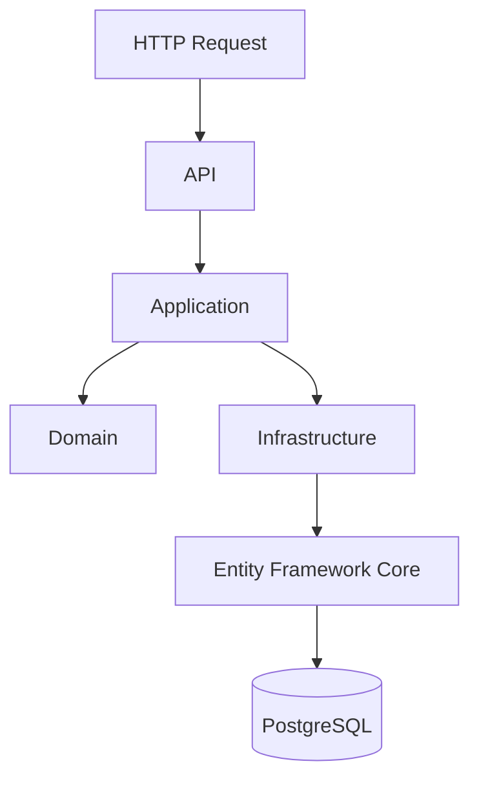

# ClimbaTodo

**A RESTful API for task management built with .NET 10, ASP.NET Core, PostgreSQL and Clean Architecture.**

[Português](#português) | [English](#english)

---

# Português

## Sobre o projeto

ClimbaTodo é uma API RESTful para gerenciamento de tarefas (To-Do), desenvolvida com ASP.NET Core e .NET 10.

O projeto utiliza Clean Architecture para separar as responsabilidades da aplicação, mantendo as regras de negócio independentes dos detalhes de infraestrutura e persistência.

A API permite criar, consultar, atualizar, concluir e excluir tarefas, utilizando PostgreSQL como banco de dados.

**API em produção:** https://climba-todo.vercel.app/api/todos

**Repositório:** https://github.com/gesielbr/climba-todo

## Funcionalidades

- Criar tarefas com título e descrição opcional.
- Listar todas as tarefas.
- Consultar uma tarefa pelo identificador.
- Atualizar título e descrição.
- Marcar tarefas como concluídas.
- Excluir tarefas.
- Validar regras de negócio na camada Domain.
- Persistir dados utilizando Entity Framework Core.

## Tecnologias

- C# e .NET 10
- ASP.NET Core Web API
- Entity Framework Core 10
- PostgreSQL
- Npgsql
- Scalar / OpenAPI
- Docker
- Vercel

## Arquitetura

O projeto segue os princípios da Clean Architecture, organizado em quatro camadas:

```text
backend/
└── src/
    ├── ClimbaTodo.API/
    │   └── Controllers/
    │
    ├── ClimbaTodo.Application/
    │   ├── DTOs/
    │   ├── Interfaces/
    │   └── Services/
    │
    ├── ClimbaTodo.Domain/
    │   └── Entities/
    │
    └── ClimbaTodo.Infrastructure/
        ├── Persistence/
        │   ├── Configurations/
        │   └── Migrations/
        └── Repositories/
```

### Responsabilidades das camadas

**API**

- Expõe os endpoints HTTP.
- Recebe as requisições e encaminha as operações para a camada Application.
- Configura os serviços e o pipeline da aplicação.

**Application**

- Implementa os serviços de aplicação.
- Define os contratos dos repositórios.
- Contém os DTOs utilizados na comunicação com a API.

**Domain**

- Contém a entidade Todo.
- Centraliza as regras de negócio e validações.
- Não depende das outras camadas da aplicação.

**Infrastructure**

- Implementa os repositórios.
- Gerencia a persistência com Entity Framework Core.
- Configura o acesso ao PostgreSQL e o mapeamento das entidades.

### Fluxo simplificado



## Regras de negócio

A entidade `Todo` possui as seguintes propriedades:

| Propriedade | Tipo      | Descrição                  |
| ----------- | --------- | -------------------------- |
| Id          | Guid      | Identificador único        |
| Title       | string    | Título da tarefa           |
| Description | string?   | Descrição opcional         |
| IsCompleted | bool      | Status de conclusão        |
| CreatedAt   | DateTime  | Data de criação            |
| UpdatedAt   | DateTime? | Data da última atualização |

Validações implementadas:

- O título é obrigatório.
- O título aceita até 150 caracteres.
- A descrição aceita até 1.000 caracteres.
- Novas tarefas são criadas como não concluídas.
- As datas são registradas em UTC.
- Uma tarefa já concluída não sofre alteração ao receber novamente a operação de conclusão.

## Endpoints

Rota-base: `/api/todos`

| Método | Endpoint                   | Descrição              |
| ------ | -------------------------- | ---------------------- |
| GET    | `/api/todos`               | Lista todas as tarefas |
| POST   | `/api/todos`               | Cria uma tarefa        |
| GET    | `/api/todos/{id}`          | Consulta uma tarefa    |
| PUT    | `/api/todos/{id}`          | Atualiza uma tarefa    |
| PATCH  | `/api/todos/{id}/complete` | Conclui uma tarefa     |
| DELETE | `/api/todos/{id}`          | Exclui uma tarefa      |

### Exemplos de requisição

**Criar uma tarefa — POST**

`POST /api/todos`

```json
{
  "title": "Estudar Clean Architecture",
  "description": "Revisar responsabilidades das camadas"
}
```

**Atualizar uma tarefa — PUT**

`PUT /api/todos/{id}`

```json
{
  "title": "Estudar .NET 10",
  "description": "Praticar desenvolvimento de APIs"
}
```

**Concluir uma tarefa — PATCH**

`PATCH /api/todos/{id}/complete`

Não é necessário enviar um corpo JSON.

## Configuração e execução local

### Pré-requisitos

- .NET 10 SDK
- PostgreSQL
- Git

### 1. Clonar o repositório

```bash
git clone https://github.com/gesielbr/climba-todo.git
cd climba-todo/backend
```

### 2. Configurar as variáveis de ambiente

Crie um arquivo `.env` na pasta `backend`, com as seguintes variáveis:

```env
PGHOST=seu_host
PGDATABASE=seu_banco
PGUSER=seu_usuario
PGPASSWORD=sua_senha
PORT=8080
```

Utilize um banco PostgreSQL compatível com os requisitos de conexão TLS e Channel Binding configurados na aplicação.

**Importante:** não envie o arquivo `.env` para o Git. As credenciais devem permanecer fora do controle de versão.

### 3. Executar a aplicação

Na pasta `backend`, execute:

```bash
dotnet run --project src/ClimbaTodo.API/ClimbaTodo.API.csproj
```

A API utilizará a porta configurada na variável `PORT`, com valor padrão `8080`.

### 4. Documentação interativa

Em ambiente de desenvolvimento, a aplicação disponibiliza OpenAPI e Scalar para explorar os endpoints.

## Banco de dados

O projeto utiliza PostgreSQL com Entity Framework Core e Npgsql.

As configurações de mapeamento estão em `TodoConfiguration`, e as migrations são mantidas no repositório para versionar a evolução do esquema do banco.

## Deploy

A aplicação está hospedada na Vercel utilizando container Docker.

O arquivo `Dockerfile.vercel`, localizado na raiz do repositório, é responsável por:

- Restaurar e compilar os projetos.
- Publicar a aplicação em modo Release.
- Preparar a imagem utilizando o runtime ASP.NET.
- Executar a API no container.

As credenciais do banco são configuradas por variáveis de ambiente na plataforma de hospedagem.

---

# English

## About the project

ClimbaTodo is a RESTful API for task management (To-Do), built with ASP.NET Core and .NET 10.

The project follows Clean Architecture principles to separate application responsibilities, keeping business rules independent from infrastructure and persistence concerns.

The API supports creating, retrieving, updating, completing, and deleting tasks, using PostgreSQL as its database.

**Production API:** https://climba-todo.vercel.app/api/todos

**Repository:** https://github.com/gesielbr/climba-todo

## Features

- Create tasks with a title and optional description.
- Retrieve all tasks.
- Retrieve a task by its identifier.
- Update task titles and descriptions.
- Mark tasks as completed.
- Delete tasks.
- Enforce business rules in the Domain layer.
- Persist data using Entity Framework Core.

## Technologies

- C# and .NET 10
- ASP.NET Core Web API
- Entity Framework Core 10
- PostgreSQL
- Npgsql
- Scalar / OpenAPI
- Docker
- Vercel

## Architecture

The project follows Clean Architecture principles and is organized into four layers:

**API**

- Exposes HTTP endpoints.
- Handles incoming requests and delegates operations to the Application layer.
- Configures application services and the HTTP pipeline.

**Application**

- Implements application services.
- Defines repository contracts.
- Contains DTOs used for API communication.

**Domain**

- Contains the Todo entity.
- Centralizes business rules and validations.
- Remains independent of the other application layers.

**Infrastructure**

- Implements repository contracts.
- Handles persistence using Entity Framework Core.
- Configures PostgreSQL access and entity mappings.

### Simplified request flow


## Business rules

The `Todo` entity contains the following properties:

| Property    | Type      | Description           |
| ----------- | --------- | --------------------- |
| Id          | Guid      | Unique identifier     |
| Title       | string    | Task title            |
| Description | string?   | Optional description  |
| IsCompleted | bool      | Completion status     |
| CreatedAt   | DateTime  | Creation timestamp    |
| UpdatedAt   | DateTime? | Last update timestamp |

Implemented validations:

- The title is required.
- The title accepts up to 150 characters.
- The description accepts up to 1,000 characters.
- New tasks are created as incomplete.
- Timestamps are stored in UTC.
- Completing an already completed task does not change its state.

## API endpoints

Base route: `/api/todos`

| Method | Endpoint                   | Description        |
| ------ | -------------------------- | ------------------ |
| GET    | `/api/todos`               | Retrieve all tasks |
| POST   | `/api/todos`               | Create a task      |
| GET    | `/api/todos/{id}`          | Retrieve a task    |
| PUT    | `/api/todos/{id}`          | Update a task      |
| PATCH  | `/api/todos/{id}/complete` | Complete a task    |
| DELETE | `/api/todos/{id}`          | Delete a task      |

### Request examples

**Create a task — POST**

`POST /api/todos`

```json
{
  "title": "Study Clean Architecture",
  "description": "Review layer responsibilities"
}
```

**Update a task — PUT**

`PUT /api/todos/{id}`

```json
{
  "title": "Study .NET 10",
  "description": "Practice API development"
}
```

**Complete a task — PATCH**

`PATCH /api/todos/{id}/complete`

No JSON request body is required.

## Local setup and execution

### Prerequisites

- .NET 10 SDK
- PostgreSQL
- Git

### 1. Clone the repository

```bash
git clone https://github.com/gesielbr/climba-todo.git
cd climba-todo/backend
```

### 2. Configure environment variables

Create a `.env` file inside the `backend` directory:

```env
PGHOST=your_host
PGDATABASE=your_database
PGUSER=your_username
PGPASSWORD=your_password
PORT=8080
```

Use a PostgreSQL database compatible with the TLS and Channel Binding requirements configured by the application.

**Important:** Never commit the `.env` file. Keep credentials outside version control.

### 3. Run the application

From the `backend` directory, execute:

```bash
dotnet run --project src/ClimbaTodo.API/ClimbaTodo.API.csproj
```

The API uses the port defined by the `PORT` environment variable, defaulting to `8080`.

### 4. Interactive API documentation

In the development environment, the application exposes OpenAPI and Scalar to explore the available endpoints.

## Database

The project uses PostgreSQL with Entity Framework Core and Npgsql.

Entity mappings are defined in `TodoConfiguration`, and database migrations are maintained in the repository to track schema evolution.

## Deployment

The application is deployed on Vercel using a Docker container.

The `Dockerfile.vercel` file, located in the repository root, is responsible for:

- Restoring and building the projects.
- Publishing the application in Release mode.
- Preparing the image using the ASP.NET runtime.
- Running the API inside the container.

Database credentials are configured through environment variables on the hosting platform.

---

**Developed as a practical project to explore .NET 10, REST API development, Clean Architecture, and PostgreSQL integration.**
